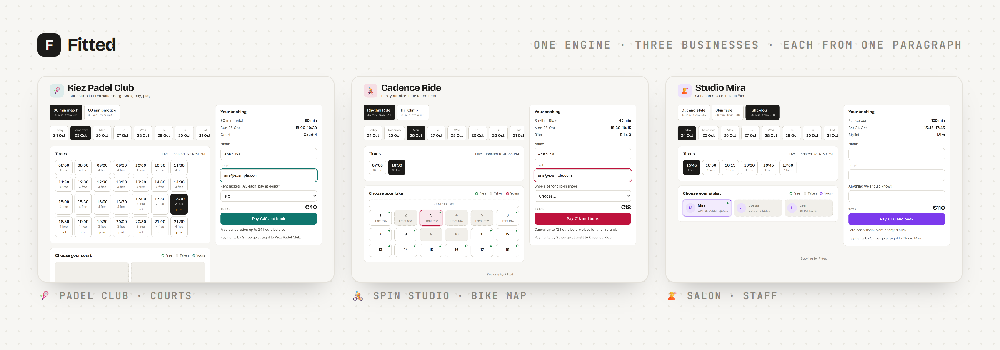
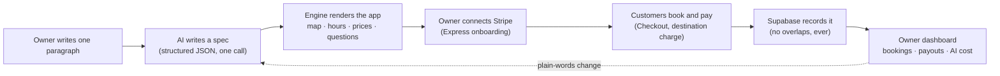
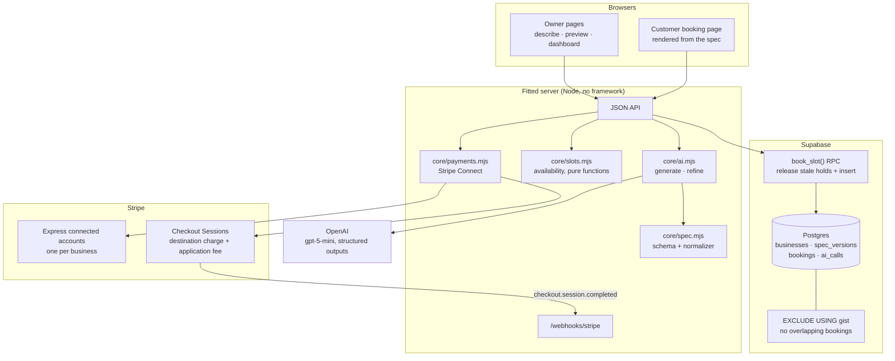
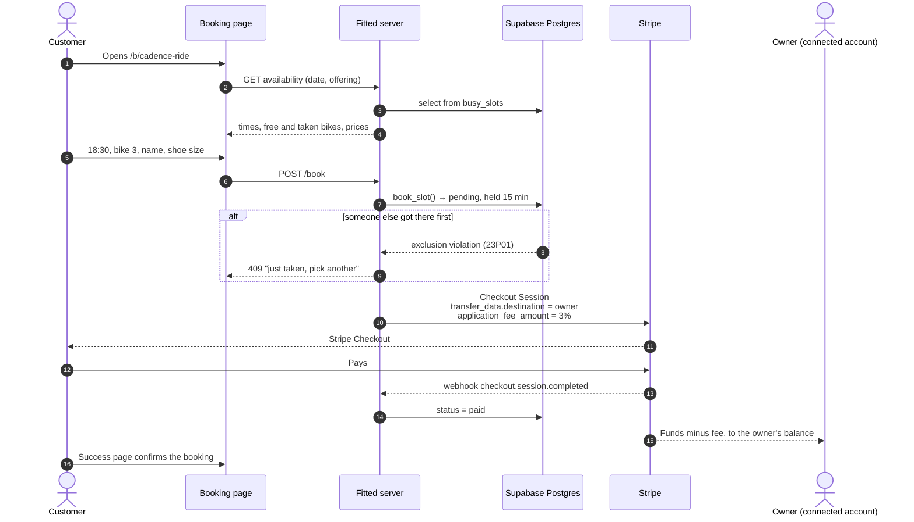

# Fitted

**Describe your business. Get booking software that fits it.**

A small-business owner writes one paragraph: "padel club, 4 courts, €32 a match, €40 after 5pm". Fitted turns it into a working booking app: a floor map of the courts, opening hours, peak pricing, checkout questions. Customers pay through **Stripe Connect** straight into the owner's own Stripe account. **Supabase Postgres** stores everything and refuses double bookings at the database level. The same engine produces a spin studio where riders pick a bike on a map, or a salon where clients choose a stylist.

Built by **Paras Adlakha** and **Harshita Adlakha** for **Stripe × Supabase: AI Payments for the Real Economy Hack**, Berlin, October 24, 2026.

**🎬 [Narrated 2-minute demo](docs/video/Fitted-demo-2min.mp4)** · [3-minute pitch video](docs/video/Fitted-pitch-3min.mp4) · [Captioned walkthrough (silent)](docs/video/Fitted-demo.mp4) · **📑 [Slides (PDF)](docs/slides/Fitted-slides.pdf)** · [PowerPoint](docs/slides/Fitted-slides.pptx) · [Project page](https://parasadlakha.github.io/fitted/)



*One codebase and one database schema, three different products, each generated from a paragraph: a padel club with courts, a spin studio with a bike map, a salon with staff.*

**Contents:** [The hackathon](#the-hackathon) · [The problem](#the-problem) · [What Fitted does](#what-fitted-does) · [Architecture](#architecture) · [How a booking works](#how-a-booking-works) · [Stripe Connect](#stripe-connect) · [Supabase](#supabase) · [AI and keeping costs low](#ai-and-keeping-costs-low) · [Run it yourself](#run-it-yourself) · [Repository layout](#repository-layout) · [What we learned](#what-we-learned) · [Limitations and roadmap](#limitations-and-roadmap) · [Team](#team) · [References](#references)

---

## The hackathon

| | |
|---|---|
| **Event** | Stripe × Supabase: AI Payments for the Real Economy Hack ([Luma page](https://luma.com/vx78o719)) |
| **Date and place** | Saturday, October 24, 2026, 10:00–20:00 · Revent, Rosenthaler Str. 13, Berlin |
| **Hosts** | the22nd Events (Julia Fontana, Elie Joseph, Teemu Kinos) · with Stripe, Supabase and Revent |
| **Brief** | "Build what small businesses actually need." A business owner describes what they need, and your product adapts to it. The same engine could give a gym class booking with a bike map, a salon staff scheduling and a padel club court booking |
| **Must use** | Stripe Connect, Supabase and AI |
| **Demo** | Show the problem, how AI adapts the product, how Stripe and Supabase power it, and how you keep costs low |
| **Stakes** | €1,500 in cash prizes, platform credits and subscriptions |

### What the brief asked for, and where it is in Fitted

| Brief | Fitted |
|---|---|
| Owner describes what they need | One paragraph on the home page, or a plain-words change on the dashboard ("add a Sunday 11:00 class") |
| Product adapts | The AI writes a **spec**; the same renderer turns it into courts, a bike map or staff cards. No code is generated |
| Gym class with a bike map | `class` mode: seats laid out facing the instructor, front-row surcharge, live taken/free |
| Salon staff scheduling | `staff` mode: stylists as cards, services limited to the right people |
| Padel court booking | `resource` mode: courts in a grid, 90-minute slots, peak pricing |
| Stripe Connect | Express accounts per business, destination charges with a platform application fee |
| Supabase | Postgres with an exclusion constraint against double bookings, RLS, spec version history, AI call metering |
| Keep costs low | AI runs only at setup and on changes, about $0.002 per call; bookings never call a model |

---

## The problem

Small businesses run on bookings, and the software choice is bad either way.

- There were about **34 million enterprises in the EU in 2024, and 99% of them had fewer than 50 people** (Eurostat figures, reported by Portugal Global).
- They either pay for **vertical software** built for one industry (court booking, salon software, studio software), each with its own subscription, or they **make do with generic tools**: a calendar link, a spreadsheet, a WhatsApp group and bank transfers.
- Generic tools don't understand the business. A calendar can't show a bike map, a court can be double-booked, and nobody pays upfront. Vendor data puts no-show rates at **15–25% for salons and 10–20% for fitness studios**, and reports that deposits or upfront payment cut no-shows by **about 45%** (Square data, via SchedulingKit; vendor figures, treat as directional).
- The appointment-scheduling software market alone is estimated at **about $497 million in 2025** (Straits Research), and most of the long tail of businesses is not served by any of it.

**Our bet:** most booking businesses are the same three shapes underneath. If an AI can map a business onto one of those shapes, a single engine can serve all of them at the cost of generic software, with payments built in.

---

## What Fitted does



| Step | What happens | Powered by |
|---|---|---|
| **Describe** | "Spin studio, 18 bikes in 3 rows facing the instructor, €18 rides weekdays at 7am…" | Owner |
| **Configure** | The model returns a spec that must match a strict JSON schema, then the engine checks and repairs it | OpenAI structured outputs |
| **Preview** | The owner sees the floor map and a plain-language summary of what the AI understood, plus what the call cost | Engine |
| **Publish** | A business row and a secret owner key; a public booking link | Supabase |
| **Get paid** | One click creates a Stripe Express account and opens Stripe-hosted onboarding | Stripe Connect |
| **Book** | Customer picks a time and a court, bike or stylist; Postgres holds it for 15 minutes; Stripe Checkout takes the money | Supabase + Stripe |
| **Change** | "Add a Sunday 11:00 class. Front-row bikes cost €4 more." A new spec version, live immediately | AI + Supabase |

### Three modes cover the brief

| Mode | Shape | Examples | What the customer picks |
|---|---|---|---|
| `resource` | A unit for a length of time | Padel and tennis courts, rehearsal rooms, boats, saunas | Time, then a court on the map |
| `class` | A seat in a scheduled session | Spin bikes, yoga mats, reformers, workshop places | Session, then a bike on the map |
| `staff` | A person for a service | Stylists, barbers, physios, tutors | Service, time, then a person |

The spec also carries the owner's own vocabulary (Court, Bike, Stylist), brand colour, peak windows, per-unit surcharges (indoor court, front-row bike), which services each person offers, extra checkout questions (racket rental, shoe size) and the cancellation policy.

---

## Architecture



**Why it is built this way**

- **Config, not code.** The AI never writes code. It fills in a schema, and a single tested renderer runs it. That makes every generated app safe, fast and free to serve, and an owner's change is a new row, not a deploy.
- **Trust nothing the model returns.** The schema is enforced by OpenAI's strict structured outputs, then `normalizeSpec` checks it again: clamps prices and durations, removes duplicate keys, drops references to units that don't exist, fixes bad times and colours, and renumbers seats in reading order.
- **The database is the referee.** Two customers clicking the same bike at the same second is a race that app code gets wrong. A Postgres exclusion constraint makes it impossible; the slower request gets a clean "just taken" message.
- **Every part runs without keys.** With no Supabase, Stripe or OpenAI keys set, Fitted uses an in-memory store, a local checkout page and hand-written templates. The status chips on every page show which parts are live.

---

## How a booking works



The success page also asks Stripe whether the session is paid, so a booking confirms even when no webhook can reach a laptop at a hackathon.

---

## Stripe Connect

| What | How | Code |
|---|---|---|
| **One account per business** | **Accounts v2**: `v2.core.accounts.create({ dashboard: 'express', configuration: { merchant: card_payments, recipient: stripe_transfers }, defaults.responsibilities: application })` | `core/payments.mjs` `onboardingLink` |
| **Stripe-hosted onboarding** | `v2.core.accountLinks.create({ use_case: { type: 'account_onboarding' } })`; KYC, bank details and terms are all Stripe's job | `onboardingLink` |
| **Is the owner ready?** | `charges_enabled` from `accounts.retrieve`, refreshed on dashboard load and by the `account.updated` webhook | `accountStatus`, `/webhooks/stripe` |
| **Customer pays the business** | Checkout Session with `payment_intent_data.transfer_data.destination` = the business account (destination charge) | `checkout` |
| **Platform revenue** | `application_fee_amount` = 3% of the booking (`PLATFORM_FEE_PERCENT`) | `feeFor` |
| **Owner's own Stripe view** | `accounts.createLoginLink` opens the Express dashboard from the Fitted dashboard | `dashboardLink` |
| **Abandoned checkouts** | Sessions expire after 30 minutes; `checkout.session.expired` releases the held slot | `/webhooks/stripe` |

Fitted never sees card details, and owners never have to sign up for Stripe separately or paste API keys.

**Verified in test mode:** a real Checkout payment of €18.00 for bike 9 at Cadence Ride produced a charge with `application_fee_amount` €0.54, `transfer_data.destination` set to the studio's connected account, and a transfer created. The Supabase booking flipped to `paid` from the success redirect.

---

## Supabase

`supabase/schema.sql` is the whole backend schema: four tables, one view, one function.

| Object | Purpose |
|---|---|
| `businesses` | One row per business: slug, owner key, the **spec as `jsonb`**, Stripe account and status |
| `spec_versions` | Every plain-words change, with the instruction and the resulting spec, for history and rollback |
| `bookings` | One row per booked unit and time range: `pending` (held 15 min), `paid` or `cancelled` |
| `constraint no_overlap` | `EXCLUDE USING gist (business_id WITH =, resource_key WITH =, tstzrange(starts_at, ends_at) WITH &&) WHERE (status <> 'cancelled')` |
| `book_slot()` | One RPC that releases expired holds and inserts the booking, so a stale hold never blocks a real customer |
| `ai_calls` | Model, tokens and cost of every AI call, shown to the owner |
| `busy_slots` view | The only thing the public could read: which units are busy, never who booked them |
| Row level security | On for every table with no policies, so the anon key can read nothing; the server uses the service key |

Because a padel club, a spin studio and a salon are all "a unit, a time range, a status", they share one `bookings` table and one constraint. Adding a new kind of business needs no migration.

---

## AI and keeping costs low

| Cost lever | What we did |
|---|---|
| **AI at setup, not per booking** | The model runs when an owner creates or changes their app. Customers browsing and booking never call it, so AI cost stays flat as bookings grow |
| **Small model, minimal reasoning** | `gpt-5-mini` with `reasoning_effort: minimal` and strict structured outputs: about 2,500 tokens, **about $0.002 per call**, 8–12 seconds |
| **Metered and shown** | Every call is logged in `ai_calls`; the dashboard shows the owner exactly what their app cost to configure |
| **No per-tenant infrastructure** | Every business is a row and a JSON spec on one server and one database. No generated code, no builds, no deploys |
| **Payments pay for themselves** | Stripe Connect's application fee is the business model, so there is no subscription the business has to justify |
| **Free tiers** | Supabase free tier and Stripe pay-as-you-go cover a pilot with dozens of businesses |

**Rough unit economics for one business:** setup and five changes ≈ $0.012 of AI, once. A club taking 300 bookings a month at €32 brings in €9,600 of payments, and a 3% fee is €288 a month for the platform, against near-zero marginal infrastructure cost. *Illustrative; Stripe's processing fees and Connect account fees apply on top and depend on country and pricing plan.*

---

## Run it yourself

**Requirements:** Node 22 or newer. Optional: a Supabase project, a Stripe account in test mode with Connect enabled, an OpenAI key. Without them, the app runs on local stand-ins.

```bash
git clone https://github.com/ParasAdlakha/fitted.git
cd fitted
npm install
cp .env.example .env.local
npm test          # 12 tests, no keys needed
npm start         # http://localhost:8790
```

**Make it live**

1. **Supabase:** run `supabase/schema.sql` in the SQL editor, then set `SUPABASE_URL` and `SUPABASE_SERVICE_ROLE_KEY` (the legacy `service_role` key or a new `sb_secret_…` key; the publishable key cannot read the RLS-locked tables). `npm run seed` creates the three demo businesses and prints their owner links.
2. **Stripe:** in a sandbox / test mode, enable Connect (Connect → Get started → "You collect payments and pay recipients"), set `STRIPE_SECRET_KEY` and `STRIPE_CONNECT_COUNTRY` to your platform's country (a US sandbox needs `US`). Optionally set `STRIPE_DEMO_ACCOUNT` to an already-onboarded test connected account; `npm run seed` attaches it to the demo businesses so they can take payments immediately. For webhooks locally: `stripe listen --forward-to localhost:8790/webhooks/stripe` and set `STRIPE_WEBHOOK_SECRET`.
3. **OpenAI:** set `OPENAI_API_KEY`. `AI_MODEL` changes the model.

Then open `http://localhost:8790`, describe a business, publish, connect Stripe (use Stripe's test onboarding values), open the booking link and pay with card `4242 4242 4242 4242`.

---

## Repository layout

```
core/
  spec.mjs        The spec: strict JSON schema for the model, and normalizeSpec that repairs anything
  ai.mjs          generate (paragraph → spec) and refine (spec + change → spec); metered
  slots.mjs       Availability, time zones, peak prices: pure functions
  payments.mjs    Stripe Connect: Express accounts, onboarding, Checkout with destination charges
  store.mjs       Supabase data access, and an in-memory store with the same rules
  templates.mjs   Three hand-written specs: few-shot example, offline fallback, tests
  seed.mjs        Creates the three demo businesses
  config.mjs      Every setting in one place
server/
  server.mjs      node:http server: pages, JSON API, Stripe webhook
public/
  index.html      Owner: describe, preview, publish
  book.html       Customer: the booking app, rendered from the spec
  owner.html      Owner dashboard: Stripe, bookings, plain-words changes, AI cost, versions
  render.js       Shared renderer: floor maps, summaries
supabase/
  schema.sql      Tables, exclusion constraint, book_slot RPC, RLS
scripts/seed.mjs  Seeds demo businesses into the configured store
test/             node --test: spec repair, time zones, availability, end-to-end booking
docs/             Screenshots, slides and the project page
```

---

## What we learned

- **Ask the model for config, not code.** A strict schema plus a normalizer turned "AI that builds apps" from a demo risk into something we could test with plain unit tests.
- **Models number seats column by column.** Asked for 18 bikes in 3 rows, the model kept producing a front row of 1, 2, 3, 10, 13, 16. We stopped fighting it in the prompt and renumbered seats in the normalizer, keeping notes and surcharges with the position.
- **"Weekdays" was off by one.** Without spelling out ISO weekday numbers in both the schema and the prompt, the model shifted weekday classes to Tuesday to Saturday.
- **Double booking belongs in the database.** An exclusion constraint on `tstzrange` is a few lines of SQL and removes a whole class of race conditions that app-level checks miss.
- **New Connect platforms must use Accounts v2.** `accounts.create({ type: 'express' })` is rejected for new platforms; v2 accounts declare a `merchant` and a `recipient` configuration and who collects fees and covers losses. Reading them through v1 `accounts.retrieve` still reports `charges_enabled`.
- **`payment_method_types` is gone from Checkout.** Payment methods now come from Dashboard settings (dynamic payment methods), so the code no longer picks them.
- **Don't depend on webhooks at a hackathon.** Confirming payment on the success redirect as well as by webhook kept the demo working on a laptop behind venue Wi-Fi.

---

## Limitations and roadmap

**Limitations today**
- Owner sign-in is a secret key kept in the browser, not Supabase Auth.
- No refunds or cancellations by customers yet; owners handle them in their Stripe dashboard.
- One time zone and one currency per business; no recurring memberships or class packs.
- Availability refreshes every five seconds rather than over a live subscription.

**Roadmap**
- Supabase Auth for owners, and Supabase Realtime for live seat maps.
- Memberships and class packs with Stripe Billing on the connected account.
- Self-serve cancellation and refunds within the policy the AI wrote.
- Deposits instead of full prepayment, configurable in plain words.
- Image upload of a floor plan, so the AI can lay out the map from a photo.

---

## Team

| | Background | Role on Fitted |
|---|---|---|
| **Paras Adlakha** | Aerospace, electronics, systems engineering | Engine, Stripe Connect and Supabase |
| **Harshita Adlakha** | System dynamics, socio-technical systems | Research, product and AI spec design |

---

## References

- Eurostat business statistics for 2024, reported in [Portugal Global, "EU businesses: €10.9 trillion in value added in 2024"](https://www.portugalglobal.pt/en/news/2026/outubro/eu-businesses-109-trillion-in-value-added-in-2024/).
- [Straits Research, Appointment Scheduling Software Market](https://straitsresearch.com/report/appointment-scheduling-software-market): USD 496.9 million in 2025. Other firms estimate $448–547 million; definitions differ.
- No-show rates and the effect of deposits: [SchedulingKit, average no-show rates by industry](https://schedulingkit.com/blog/average-no-show-rates-by-industry) and [no-show statistics](https://schedulingkit.com/statistics/no-show-statistics). These are vendor figures without linked primary studies, so treat them as directional.
- Tools: [Stripe Connect](https://docs.stripe.com/connect) · [Destination charges](https://docs.stripe.com/connect/destination-charges) · [Supabase](https://supabase.com/docs) · [Postgres exclusion constraints](https://www.postgresql.org/docs/current/ddl-constraints.html#DDL-CONSTRAINTS-EXCLUSION) · [OpenAI structured outputs](https://platform.openai.com/docs/guides/structured-outputs)

---

*Fitted is a hackathon prototype. Use Stripe test mode, and review Stripe's Connect terms and fees before taking real payments.*
